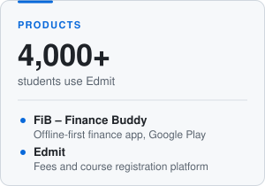
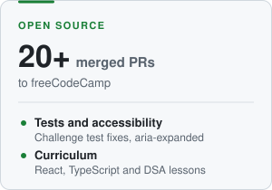
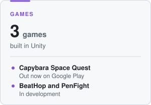
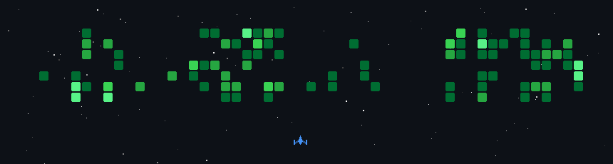

<h1>Siddharth T S</h1>

<b>Full-stack developer</b> &nbsp;·&nbsp; <b>Open-source contributor</b> &nbsp;·&nbsp; <b>Indie game developer</b>

 

 

<h3 align="center">About</h3>

CS undergraduate at MLR Institute of Technology, Hyderabad, graduating in 2027. 
I build web and mobile products, contribute to open source, and make small games in Unity. 
Open to SDE roles.

<a href="https://play.google.com/store/apps/details?id=com.fib.financebuddy"><picture><source media="(prefers-color-scheme: dark)" srcset="assets/card-products-dark.svg" /></picture></a>
<a href="https://github.com/freeCodeCamp/freeCodeCamp/pulls?q=is%3Apr+author%3ASidsmartz+is%3Amerged"><picture><source media="(prefers-color-scheme: dark)" srcset="assets/card-opensource-dark.svg" /></picture></a>
<a href="https://play.google.com/store/apps/developer?id=Sidsmartz"><picture><source media="(prefers-color-scheme: dark)" srcset="assets/card-games-dark.svg" /></picture></a>

 

<h3 align="center">Tech stack</h3>

<b>LANGUAGES</b> 

<b>FRONTEND &amp; MOBILE</b> 

<b>BACKEND &amp; DATABASES</b> 

<b>ML &amp; AI</b> 

<b>CLOUD &amp; DEVOPS</b> 

<b>GAMES &amp; TOOLS</b> 

 

<h3 align="center">Activity</h3>

  <picture><source media="(prefers-color-scheme: dark)" srcset="https://github-readme-stats.vercel.app/api?username=Sidsmartz&show_icons=true&hide_rank=true&theme=github_dark&hide_border=true" /></picture>
  <picture><source media="(prefers-color-scheme: dark)" srcset="https://github-readme-stats.vercel.app/api/top-langs/?username=Sidsmartz&layout=compact&theme=github_dark&hide_border=true" /></picture>

  

  <picture><source media="(prefers-color-scheme: dark)" srcset="https://raw.githubusercontent.com/Sidsmartz/Sidsmartz/output/snake-dark.svg" /></picture>

  

